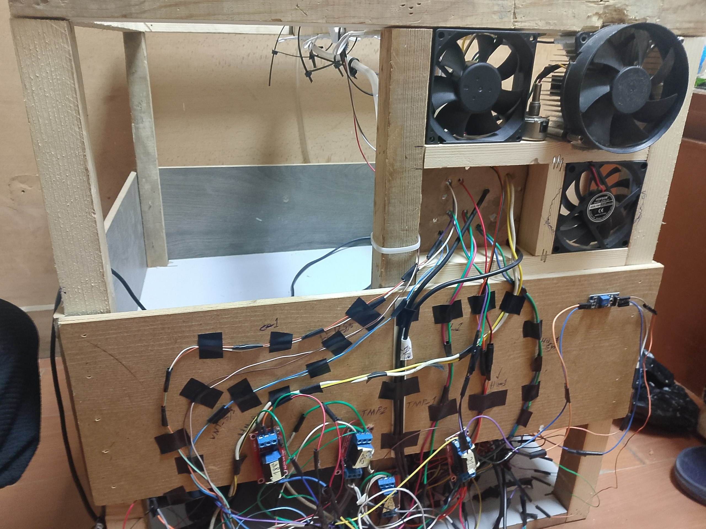
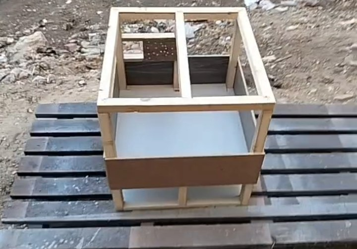
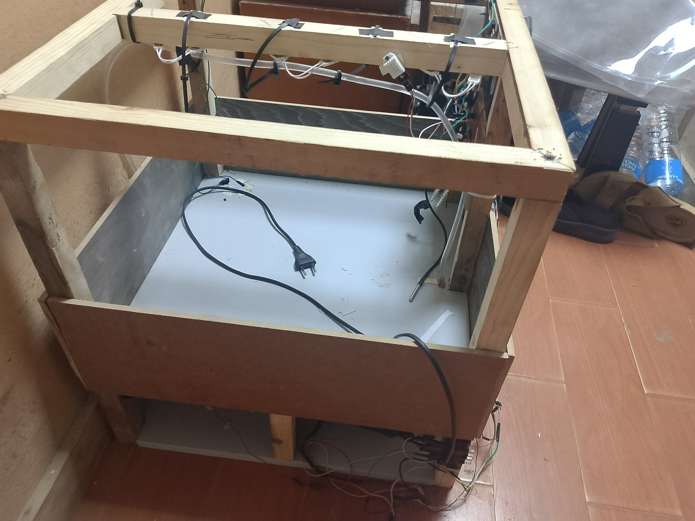
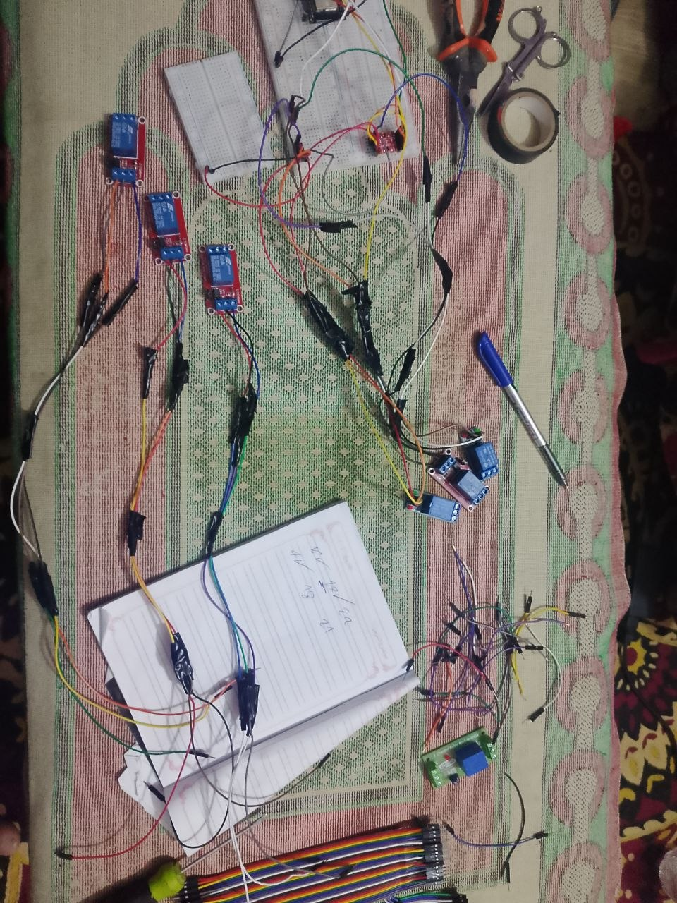
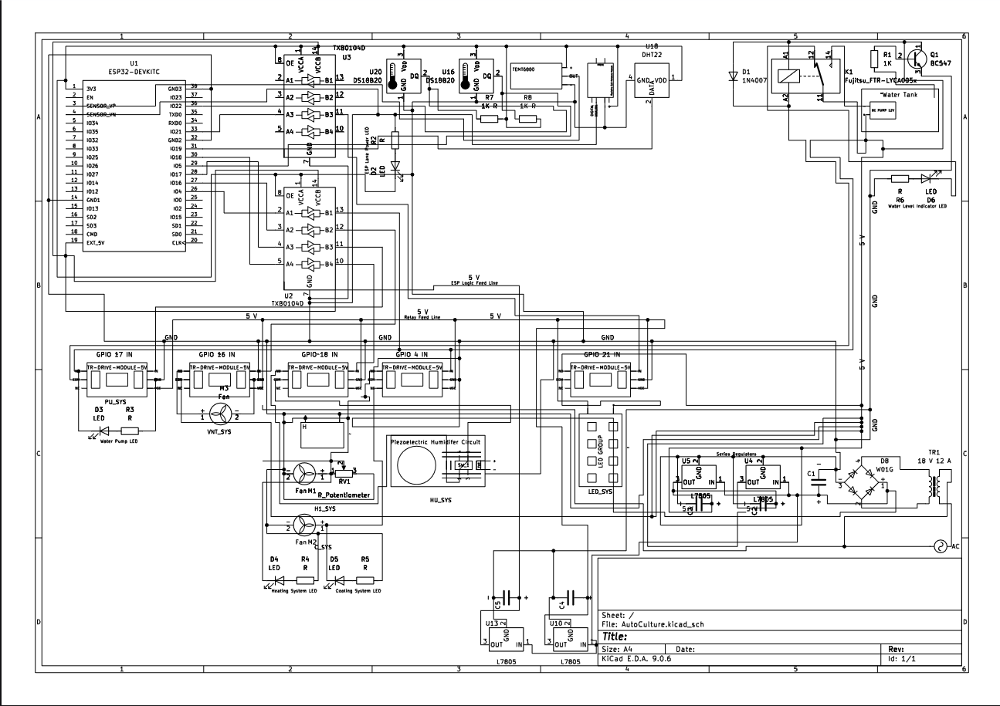
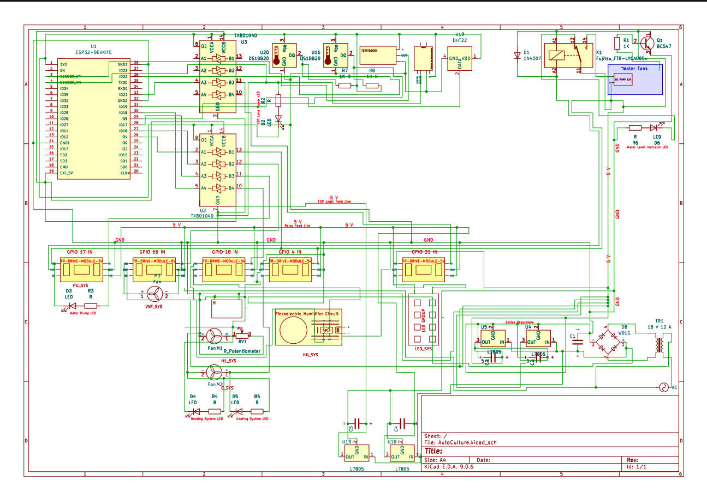
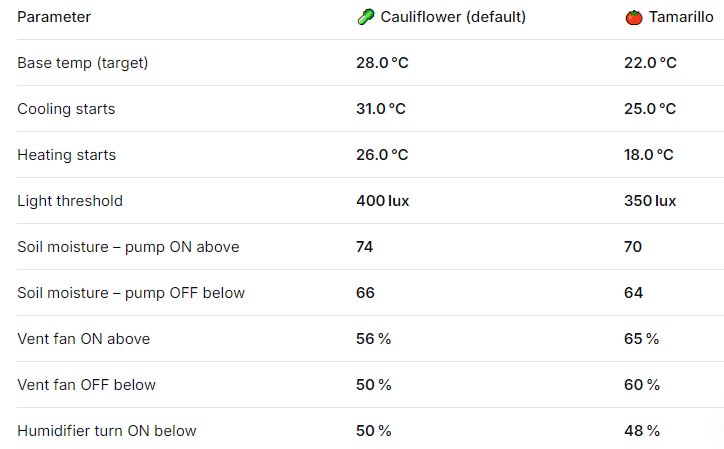

<h1 align="center">EcoGuard</h1>

--------------------------
---------------------------------
## A closed-loop greenhouse that monitors & controls temperature, humidity, light and soil moisture, logs everything to a local Excel sheet and has a user interface with manual override controls. Built as a capstone project for STEM High School for Boys - 6th of October.

### 
[Main Features](#main-features) **-** [The Capstone](#the-capstone) **-** [Problem](#the-problem) **-** [Design Requirements](#design-requirements--limitations) **-** [Prototype](#the-prototype) **-** [Schematic](#circuit-schematic) **-** [Code Note](#a-note-on-the-code) **-** [Set Values](#set-values) **-** [Testing](#testing) **-** [Real Life](#real-life-application) **-** [Files](#whats-where)

--------------------------

## Main Features

- Closed-loop control. Sensors read the greenhouse and relays switch the actuators until each parameter is back at its set value.
- Controls temperature, humidity, soil moisture and daylight LEDs for two crops. Cauliflower & Tamarillo.
- Heating by PTC heater plates with fans, drip irrigation for the soil.
- Logs readings to a local Excel sheet and sends data to a live database every 2 hours during the daily test.
- A user interface with manual override controls.
- Built from recycled wood and recycled PVC greenhouse plastic. **[Recycled non-electronic materials were a requirement this semester]**.
- The ESP32 DevKitC is the brain. Everything is wired by hand on a breadboard, there is no custom PCB.

------------------------------------
------------------------------------

## The Capstone

The capstone is the biggest thing students do at STEM High School for Boys - 6th of October. A real problem, a working prototype for it, tests, and every step documented following the Engineering Design Process (EDP). Every term has its own design requirements and limitations that the design has to fit.

It is a team project, though I handled the majority of the prototype work here, as I have on every capstone project.

It runs through grades 10 and 11. On its own it is **60%** of the degree, and with its slice in every subject it is effectively around **80%** of the grades.

It has five parts:

- **Portfolio:** 60 to 80 pages in four chapters. Grand challenges, problem to be solved, prior solutions, selection of the solution, selection of the prototype, test plan, results, analysis, real-life recommendations and real-life location.
- **Poster:** Introduction, abstract, materials, methods, analysis, test plan, conclusion, real-life recommendations, citations and acknowledgements to everyone who helped.
- **Prototype:** The physical build, tested against the test plan.
- **Journals:** Every two weeks. Questions on personal reflection and the EDP process plus two connections between the project and the subjects taken. Other schools grade them anonymously on a red, yellow, green & blue scale and they are a key factor in the degree. Scores depend on the reviewers and vary significantly.
- **Logbook:** A weekly record of the work.

**This repository holds the project files only. Parts of the portfolio, the hardware design, data, photos and the logbook.**

------------------------------------

## The Problem

Egypt's agricultural production is falling. There is only about 0.03 hectares of arable land per person since most people live on around 6% of the land, and most of the country's water goes to irrigation, much of it still flooding fields the old way.

A controlled greenhouse can grow crops on land that isn't farmland while using far less water. Full write-up in [Problem To Be Solved](Portfolio/Problem%20To%20Be%20Solved.docx).

------------------------------------

## Design Requirements & Limitations

- Keep temperature, humidity and soil moisture inside the range of the selected crops with daylight LEDs to help them grow.
- All non-electronic materials had to be recycled. **[This semester's limitation]**.

------------------------------------

## The Prototype

- A square greenhouse with a 50 cm by 50 cm base and sides 50 cm wide by 70 cm high, with a mid-piece on top holding the LEDs and the drip irrigation.
- Recycled wood frame with recycled PVC greenhouse plastic that insulates the inside and filters sunlight.
- ESP32 DevKitC with relays as the actuators.
- Heat fans, PTC heater plates, temperature, humidity and soil moisture sensors, logic converters and LEDs.
- Hand wired on a breadboard.

&nbsp;&nbsp;&nbsp;&nbsp;

<b>The frame, the interior and the relay wiring during the build.</b>

<b>3D model of the device.</b>

### Circuit Schematic

Designed in KiCad. The ESP32 reads the temperature and humidity sensors through logic level converters and switches the heater, fans, water pump, LEDs and humidifier through relay driver modules. Power comes from a transformer, a bridge rectifier and 5 V regulators.

<b>Schematic.</b>

<b>Same schematic with the colored view.</b>

Selection process in [Selection of Prototype](Portfolio/Selection%20of%20Prototype.docx).

### A Note on the Code

The ESP32 firmware is not included in this repository. The only copy was lost in a laptop migration and no teammate had a backup. The set values below and the results in the [Portfolio](Portfolio/) document what it did.

### Set Values

The target values the controller holds for each crop.

------------------------------------

## Testing

- Data goes to a live database every 2 hours during a 6-hour test each day and whenever the main device asks for it.
- While the prototype controls the parameters, the time the actuators take to return to the base value is logged.
- Sensors were calibrated against weather data, boiling water and an external thermometer. Calibration is applied in code through buffer variables.
- Current and voltage of each component were measured with a multimeter every 2 hours for 5 days to calculate power consumption.

Test plan in [test plan](Portfolio/test%20plan.docx). Logs in [Data](Data/).

------------------------------------

## Real Life Application

Recommended for STEM High School for Boys - 6th of October at a 1:10 scale. 7 m high with two square bases of 5 m. The same cooling & heating concepts apply, with the water spray behind the fans and larger heating coils.

Details in [real-life recommendations](Portfolio/real-life%20recommendatio.docx).

------------------------------------

## What's Where

- [Hardware/KiCad/Project](Hardware/KiCad/Project/) - KiCad schematic & project files
- [Hardware/KiCad/Schematic](Hardware/KiCad/Schematic/) - schematic images
- [Hardware/KiCad/Modules](Hardware/KiCad/Modules/) - ESP32 DevKitC library & 3D files
- [Portfolio](Portfolio/) - problem, prototype selection, recommendations, Chapter 1, test plan
- [Data](Data/) - logger spreadsheets & greenhouse log
- [Photos](Photos/) - photos of the built prototype
- [3D Model](3D%20Model/) - 3D model of the device
- Logbook PDF in the root

------------------------------------

## License

See [LICENSE](LICENSE).
